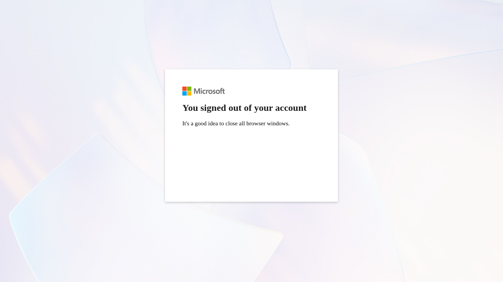
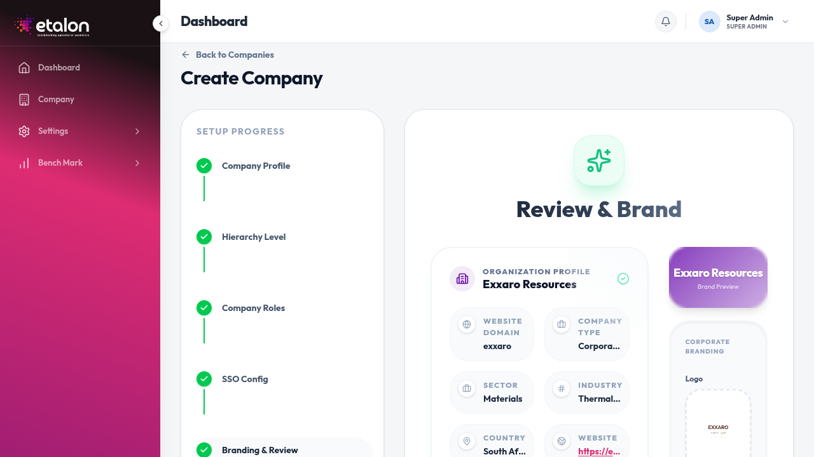
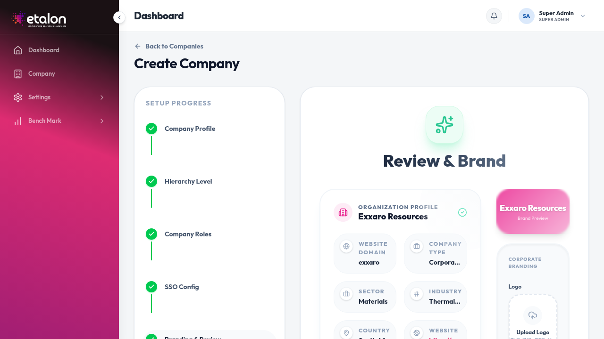
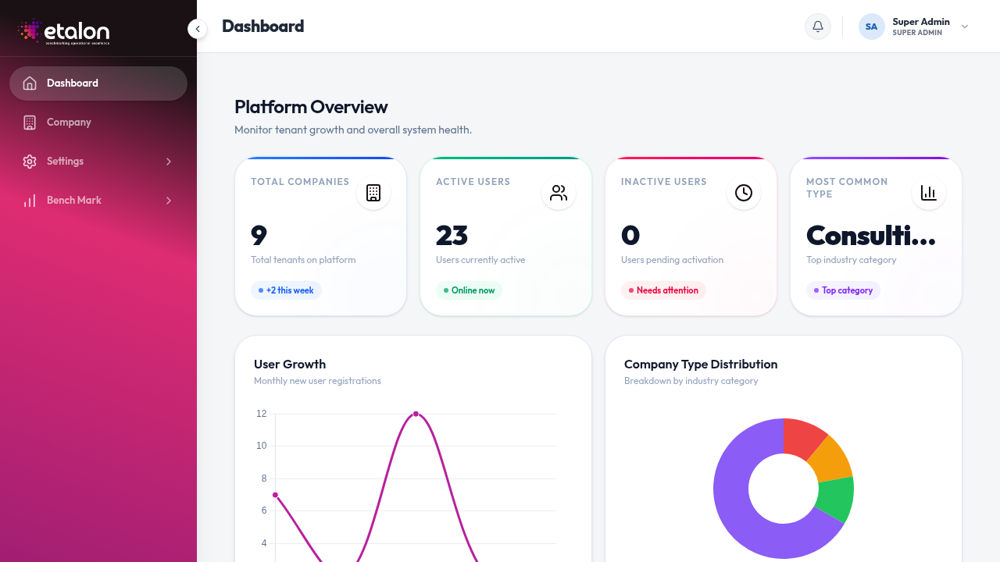
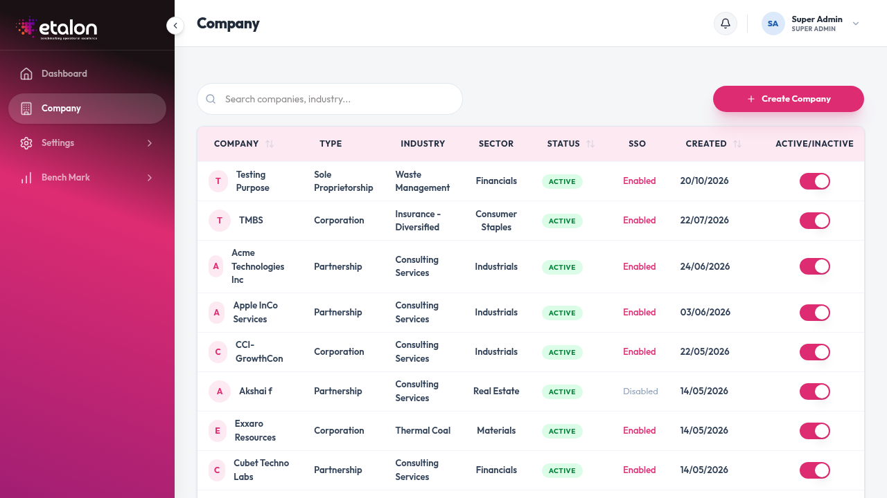

# Etalon MOS — Super Admin Console Bug Report

| | |
|---|---|
| Environment | Staging — `https://etalon-staging.cubettech.in` / API `https://etalon-staging-api.cubettech.in` |
| Role | Super Admin (`superadmin@yopmail.com`) |
| Browser | Chromium (Playwright), 1280×720 |
| Date | 2026-11-10 |
| Tester | QA (AI-assisted exploratory session) |
| Scope | Dashboard, Company (list + 5-step wizard), Settings (Industry/Company Type/Sectors), Bench Mark uploads, header (profile, notifications), session handling |

Testing was **non-destructive**: no tenant/master data was created, edited, deleted or saved.

## Summary

| ID | Title | Severity | Priority |
|---|---|---|---|
| [BUG-01](#bug-01) | Super Admin is sent to Microsoft "You signed out" dead-end on session expiry / 401 | **High** | **High** |
| [BUG-02](#bug-02) | Edit Company → after refresh/direct link, branding resets to defaults (logo cleared, colour → #E91E8C) | **High** (potential data loss) | **High** |
| [BUG-03](#bug-03) | Dashboard KPI badges/labels are hard-coded or mislabelled | Medium | Medium |
| [BUG-04](#bug-04) | All tenants have `onboardingCompleted=false` though every onboarding step is complete | Medium | Medium |
| [BUG-05](#bug-05) | Company table: Actions column cut off at 1280 px; icon buttons have no label/tooltip | Low | Medium |
| [BUG-06](#bug-06) | Notifications bell does nothing | Low | Low |
| [BUG-07](#bug-07) | Edit mode shows "Create Company" title, header "Dashboard", URL step never updates | Low | Low |
| [BUG-08](#bug-08) | Slow page/data loads (5–35 s) | Medium | Medium |

**Checked and NOT defects:** Super Admin APIs return `401` without a token; the public SSO lookup (`/user/auth/sso-credentials/<domain>`) exposes only Azure Tenant/Client IDs (public in SPA auth) — no client secret; HTML in Industry names (`<b>Bold</b>`) is escaped, no injection; Sign Out from the profile menu correctly returns to `/super-admin`.

---

## BUG-01 — Super Admin redirected to Microsoft logout dead-end when session is missing/expired

**Severity:** High  **Priority:** High  **Module:** Authentication / session handling

**Description**
When any Super Admin API call returns `401` (expired/missing token), the shared API client redirects to the **Microsoft Entra (Azure AD) logout** endpoint, which is the *tenant SSO* flow. Super Admin authenticates with email/password at `/super-admin`, so they land on Microsoft's "You signed out of your account" page with no way back. The post-logout redirect targets `/login`, which itself 404s on the bare host.

**Preconditions:** Super Admin account; no valid session (expired token, new browser, or after Sign Out).

**Steps to reproduce**
1. Open a new browser/incognito window (no Etalon session).
2. Go to `https://etalon-staging.cubettech.in/dashboard/company`.
3. Observe the redirects.

*Alternate path:* log in at `/super-admin` → profile menu → **Sign Out** → press browser **Back**.

**Expected:** User is redirected to the Super Admin login `/super-admin` (optionally with "Session expired, please sign in again").

**Actual:** Redirected to `login.microsoftonline.com/<tenant>/oauth2/v2.0/logout?post_logout_redirect_uri=https://etalon-staging.cubettech.in/login` → ends on Microsoft "You signed out of your account". Console: `GET /super-admin/companies → 401 Unauthorized`, then redirect.

**Impact:** Every Super Admin whose token expires mid-session is stranded on a Microsoft page and must know to type `/super-admin` manually. The Microsoft logout also signs the browser out of any other Microsoft 365 session.

**Evidence**

**Suggested fix:** In the 401 handler, branch on the user's auth type/role (or route prefix `/dashboard/*` vs tenant routes) and send Super Admin to `/super-admin`.

---

## BUG-02 — Edit Company: refresh or direct link resets branding to defaults

**Severity:** High (potential data loss)  **Priority:** High  **Module:** Company → Create/Edit wizard → Step 5 "Branding & Review"

**Description**
When the edit wizard is opened via the pencil icon and the user navigates to **Branding & Review**, the tenant's saved logo and brand colour are shown correctly. If the page is **refreshed** or opened via its URL (`/dashboard/company/create?step=5&id=<id>`), profile fields load but branding falls back to defaults: **logo empty ("Upload Logo")** and **Primary Brand Color = #E91E8C** instead of the saved value.

**Test data:** Exxaro Resources (`id=c79bddc1-57de-47af-90ee-10cf2e9e716d`), saved `primaryColor = #6A0DAD` (confirmed via `GET /user/auth/sso-credentials/exxaro`) with an uploaded logo.

**Steps to reproduce**
1. Log in as Super Admin → **Company**.
2. On *Exxaro Resources* click the **pencil (edit)** icon, wait for data to load.
3. Click **Branding & Review** in the Setup Progress stepper → note purple colour `#6a0dad` and the Exxaro logo. *(2a)*
4. Open `https://etalon-staging.cubettech.in/dashboard/company/create?step=5&id=c79bddc1-57de-47af-90ee-10cf2e9e716d` directly (or refresh while on the wizard) and wait ~35 s for data to load.

**Expected:** Step 5 shows the saved logo and `#6A0DAD`, same as step 3.

**Actual:** Logo slot empty ("Upload Logo"), colour field `#e91e8c` (default pink), brand preview pink. *(2b)*

**Impact:** If the admin clicks **Save Organization** in this state, the tenant's logo and brand colour are likely overwritten with defaults, breaking that tenant's white-label branding. *(Save was intentionally not clicked — dev to confirm whether the save payload includes the defaulted values.)*

**Evidence**

| Via UI (correct) | After refresh / direct link (wrong) |
|---|---|
|  |  |

**Note:** The wizard URL stays at `step=1` while the user is on step 5 (see BUG-07), so a refresh always reloads from scratch.

---

## BUG-03 — Dashboard KPI badges and labels are hard-coded / mislabelled

**Severity:** Medium  **Priority:** Medium  **Module:** Dashboard

**Steps to reproduce**
1. Log in as Super Admin → **Dashboard** (wait for "Platform Overview").
2. Compare the cards with the `GET /super-admin/dashboard` response.

| Card / widget | Shown | API / reality | Issue |
|---|---|---|---|
| Total Companies | "**+2 this week**" | No weekly field in API; newest tenant created 20/10/2026 (3 weeks ago) | Badge is static text |
| Active Users | 23 "Users currently active · **Online now**" | Value = `totalUsers` (all users) | Mislabelled — not online/active users |
| Inactive Users | 0 · "**Needs attention**" (red) | `inactiveUsers = 0` | Alert badge shown when nothing needs attention |
| Most Common **Type** | "Consulting Services" | Derived from industry counts | Label says Type, value is an Industry |
| **Company Type** Distribution | Donut chart, subtitle "Breakdown by industry category" | Uses `tenantIndustryWiseCount` | Title says Company Type, data is Industry |

**Expected:** Badges computed from data (or hidden); labels match the metric shown.

**Evidence**

---

## BUG-04 — `onboardingCompleted` is false for all tenants though every step is complete

**Severity:** Medium  **Priority:** Medium  **Module:** Company onboarding / Dashboard "Pending Activation"

**Steps to reproduce**
1. Log in as Super Admin → **Company**.
2. Inspect `GET /super-admin/companies?page=1&limit=10` (DevTools → Network).

**Actual:** All 9 tenants: `onboardingCompleted: false`, while `onboardingSteps` PROFILE, HIERARCHY_NODES, SSO, ROLE_PERMISSION and BRANDING are all `isCompleted: true` and status is `ACTIVE`. Meanwhile Dashboard → *Pending Activation* shows "No incomplete tenants" (`incompleteTenants: []`). Also *Akshai f* and *Cubets* have `ssoConfig: false` while their (required) SSO step is marked completed.

**Expected:** `onboardingCompleted` becomes `true` after the final step is saved; SSO step cannot be "completed" without an SSO config — or the flag is removed if unused.

**Impact:** Any logic depending on this flag (tenant login gating, Pending Activation, reports) will treat every tenant as un-onboarded. Needs dev confirmation of the intended source of truth.

---

## BUG-05 — Company table: Actions column cut off at 1280 px; unlabeled icon buttons

**Severity:** Low  **Priority:** Medium  **Module:** Company list

**Steps:** Browser 1280×720 → Login → **Company**.

**Actual:** Table is 1107 px wide inside a 962 px container; the **Actions** column (email + edit icons) sits at x = 1256–1392 px, outside the viewport — only reachable by horizontal scrolling inside the table. The two action buttons have no accessible name or tooltip (screen readers announce "button"; users must guess that the envelope sends an email).

**Expected:** All columns fit at ≥1280 px (or Actions column sticky); icon buttons have `aria-label`/tooltip ("Resend invite", "Edit").

---

## BUG-06 — Notifications bell does nothing

**Severity:** Low  **Priority:** Low  **Module:** Header

**Steps:** Login → click the **bell** icon in the header.
**Expected:** Notifications panel/dropdown (or the icon hidden if not in scope).
**Actual:** Button receives focus; no panel, no request, no feedback.

---

## BUG-07 — Edit wizard titles and URL state are wrong

**Severity:** Low  **Priority:** Low  **Module:** Company → Edit

**Steps:** Company → pencil on any tenant → click steps in the stepper.
**Actual:** (a) Page heading reads **"Create Company"** in edit mode; (b) header title reads **"Dashboard"**; (c) URL remains `?step=1` regardless of the visible step.
**Expected:** "Edit Company — <name>", header "Company", URL reflects the current step.
*(Visible in BUG-02 screenshots.)*

---

## BUG-08 — Slow data loads

**Severity:** Medium  **Priority:** Medium  **Module:** All list pages, edit wizard

**Observed load times (staging):** Settings → Sectors 5–12 s; Industry Type / Company Type / Bench Mark lists ~5 s; Dashboard ~10 s; Edit wizard on direct link ~35 s before data appears (UI is faded/unusable meanwhile).
**Expected:** < 3 s for list pages under normal load (SOW §5.2 "acceptable response times").
**Note:** Automation must use explicit waits for data (e.g. wait for "Loading data…" to disappear).

---

### Not covered / follow-ups
- Save paths (Create Company, Save Organization, Settings add/edit/delete, Active/Inactive toggle, CSV import) — require agreed test data to avoid altering live tenants.
- Organisation Admin console (tenant subdomain + Azure SSO account needed).
